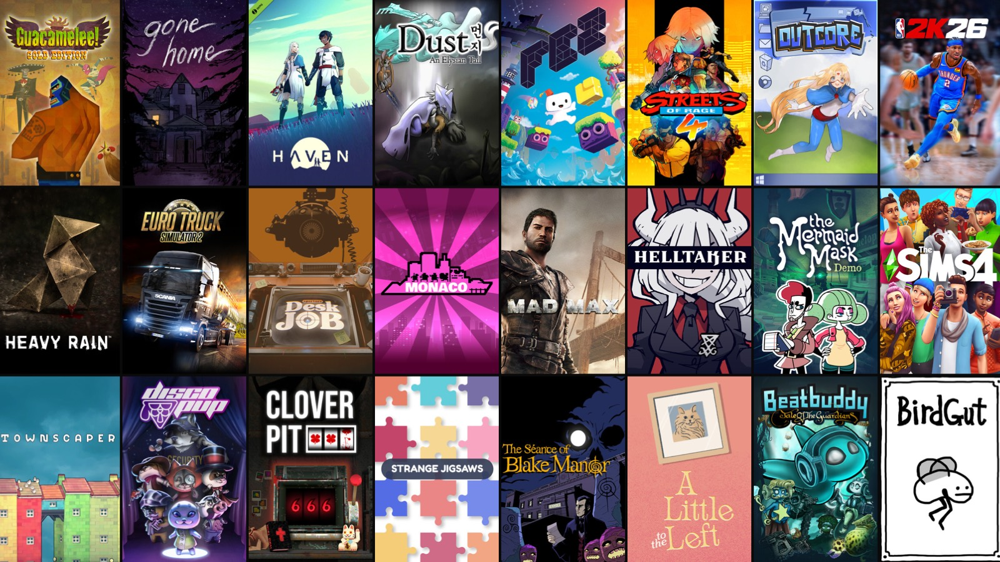

# Covers for Steam

A macOS screensaver that shows the cover art from your Steam library, read
straight from Steam's local cache. Pick Wall (a grid of tiles) or Origami
(panels that fold in new covers) under Options. Tools, dedicated servers and
apps such as SteamVR are left out unless you untick Games and demos only.




## Install

Download `Covers-for-Steam-0.2.pkg` from
[Releases](https://github.com/gkaramanis/covers-for-steam/releases), open it
and follow the steps. To use the zip instead, unzip it and double-click
`Covers for Steam.saver`. Requires macOS 14 or later, Apple silicon or Intel.

Then choose **Covers for Steam** under System Settings → Wallpaper → Screen
Saver… → Custom (macOS 26 and later) or System Settings → Screen Saver
(macOS 14 and 15).

The pkg and the zip hold the same notarized saver. The installer also handles
updates. It removes a copy in the other Screen Savers folder, which could
otherwise win over the new one, and restarts macOS's screensaver host, which
keeps the old version loaded. The zip suits anyone who would rather not run an
installer. After updating from the zip, run `killall legacyScreenSaver` in
Terminal, or log out and back in, before the new version shows.

The saver needs Steam installed with a library you have opened at least once,
so the covers are in its cache.

## Building

```sh
./build.sh --install          # build and install into ~/Library/Screen Savers
./build.sh --release          # sign, notarize, staple and zip into build/
./build.sh --pkg              # the same, plus a signed, notarized installer
swift tools/thumbnail.swift   # redraw the System Settings thumbnails
```

`tools/wall/main.swift` renders the image above from your own Steam cache.
Build and run commands are at the top of the file.

## License

MIT. Not affiliated with Valve. Steam is a trademark of Valve Corporation.
